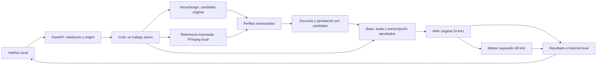

# Arquitectura y decisiones

## Flujo de trabajo

`engine.py` carga Qwen y Torch al comenzar una inferencia, no al importar el módulo o abrir el portal. La configuración utiliza un solo modelo residente por trabajo y libera sus pesos al terminar. Importar una referencia es un trabajo de CPU y FFmpeg; no necesita cargar Qwen.

## Referencias y aprobación

`profiles.py` mantiene un índice pequeño por perfil y candidatos en directorios identificados. El índice distingue el candidato más reciente de la identidad activa. Crear un diseño o importar una grabación actualiza el borrador y conserva la voz aprobada.

Cada candidato conserva `reference.wav`, `reference.txt` y metadatos. La importación registra origen, hash, duración y parámetros del corte. El diccionario de pronunciación no sustituye palabras en esa transcripción: debe describir el audio aportado.

La API rechaza aprobar un candidato que ya no sea el actual. Los enlaces de audio pueden incluir su UUID; una referencia obsoleta recibe un conflicto en vez de servir silenciosamente otra voz.

## Narración

Base construye un prompt de voz con audio y transcripción, usando `x_vector_only_mode=False`, y lo reutiliza durante el trabajo. Las frases completas se agrupan alrededor de 250 caracteres, con máximo 500 por frase. El cambio de semilla por fragmento controla muestreo; no añade aprendizaje persistente a los pesos.

El diccionario aplica reemplazos literales delimitados por palabra y no ejecuta SSML ni código. Los textos se normalizan antes de dividirlos. Los límites se comprueban antes de cargar el modelo para evitar gastar GPU en solicitudes inválidas.

## Audio e historial

`audio.py` conserva muestras FLOAT a la frecuencia original del modelo. El máster aplica normalización de sonoridad en dos pasadas y exporta PCM de 24 bits. Es una copia de entrega; el original no se sobrescribe.

`result.json` registra fragmentos, semilla, duraciones, rutas locales y métricas. El servidor genera URLs propias de descarga en vez de aceptar URLs de los resultados como destinos fiables. Al iniciar, restaura los 20 resultados completos más recientes y omite los incompletos o inválidos.

La recuperación valida el directorio de cada trabajo y los nombres conocidos de audio. Los tiempos corresponden a fragmentos completos; no hay alineación por palabra.

## Verificación

La suite CPU utiliza motores simulados, WAV temporales y FFmpeg simulado. Comprueba colas, cancelación, aprobación, rutas, formatos, tamaño real de peticiones e integridad de perfiles entre idiomas.

Las pruebas GPU se realizaron separadamente con diseño y narración en ambos idiomas. Demuestran ejecución en ese equipo; no garantizan acento, interpretación, parecido o rendimiento idénticos en otros textos o máquinas.

La clonación por referencia no equivale a entrenar. Un futuro fine-tuning requeriría otro entorno, datos autorizados, evaluación y una copia del modelo, conservando la versión actual. Ese flujo no forma parte de esta versión.
